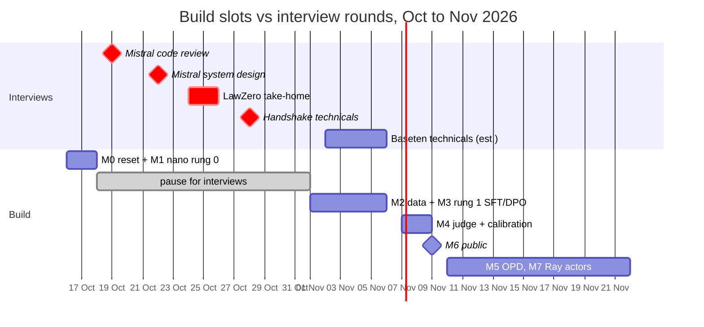

# Plan: HealthBench RFT — `nano/` trainer locally, verl on Modal

**Status (16 Oct 2026): nothing built yet.** The repo still holds the December TRL + llama.cpp
prototype; M0 replaces it. Day-by-day build slots live in the resume repo's interview plan
(`resume/interviews/2026-10-12_2026-11-08.md`); this file is the *what* and the *why*.
Previous versions of this plan are in git history (v1: tag `v0-trl-llamacpp`; v2: before this commit).

## The question

> HealthBench grades responses with an LLM judging against physician-written rubrics. If you use that
> rubric score as an RL reward, does the model get better at health conversations, or better at the
> grader? And does on-policy distillation (OPD) from a stronger open model avoid the gaming that
> rubric-reward RL falls into?

**Prediction, written before any run:** rubric-reward GRPO improves *trained* criteria most, mostly
through completeness and length; OPD moves held-out and trained criteria together, capped near the
teacher; OPD + rubric sits between. If it comes out differently, that is the README.

## What the interviews need from this repo

Interview prep always wins over the build. Each milestone below is cut by what a loop tests.

| Loop | Round(s) | What the repo gives it |
|---|---|---|
| **Handshake** MTS Post-Training | Technicals **Wed 28 Oct**: 2× post-training design, 1× eval-pipeline debugging | GRPO advantages, clip loss, KL and SFT/DPO written by hand (M1, M3); diagnosing training problems from your own logs; a rubric grader to debug (M4) |
| **LawZero** Sr ML Research Developer | Take-home **Sat 24 → Mon 26 Oct**, then onsite | The clean PyTorch template (tests, configs, seeds, README) is the take-home rehearsal; judge calibration (Brier/ECE) speaks to "honest predictor" |
| **Mistral** Applied AI FD MLE | System design **Thu 22 Oct**, then technical manager | Fine-tuning + evals story; "which lever for which customer" (SFT vs DPO vs GRPO vs OPD, M3) |
| **Baseten** FDE | Technicals, week of 2 Nov | Tinker-shaped `forward_backward` / `optim_step` learner (Loops uses the same interface); "RL rollouts as an inference workload" (M7) |

## Milestones



**Work split, so the learning is real:** you write `nano/algos.py` and the core of
`nano/learner.py` by hand. Claude writes scaffolding, data loaders, the judge client and cache,
Modal apps, analysis scripts, and **the tests, first, as the spec**. Reference solutions go on a
separate branch. Every milestone ends with `uv run pytest -q` and `uv run ruff check .` green and a
dated `notes/journal.md` entry whose prediction was written *before* the run.

| # | Milestone | When | Done when |
|---|---|---|---|
| **M0** | **Reset the repo.** Tag `v0-trl-llamacpp`; delete the old stack (list below); new `pyproject.toml` (package `rl_finetune`, extras `[nano]`, `[modal]`, dev pytest + ruff); MIT `LICENSE`; README rewritten to "what this repo is now", no results claimed; `scripts/time_model.py` → model decision in `notes/decisions.md` | Fri 16 Oct evening, ~1.5h | `uv sync --extra nano --extra dev` works, smoke test passes, model choice recorded |
| **M1** | **`nano/` stage A on rung 0.** `protocol.py` (batch dict, `chunk`/`concat`); **`algos.py` (yours):** `token_logprobs`, `grpo_advantages` (+ `norm_adv_by_std`), `ppo_clip_loss`, `kl_k3`, `aggregate_loss(mode)`; **`learner.py` (yours):** Tinker-shaped `forward_backward` / `optim_step`, micro-batches + grad accumulation, checkpointing; `generator.py` (HF `generate`, left padding, token ids out); `reward_worker.py` + `rewards/verifiers.py`; `driver.py` with W&B | Fri 16 evening (algos) + Sat 17 morning (learner, driver), ~5h | Tests pass; arithmetic reward rises over ~100 steps with reward, KL, clip fraction, ratio min/max, entropy, length and the gen-vs-learner logprob gap logged |
| **M2** | **HealthBench data.** `schema.py`, `healthbench.py` (`oss_eval`, `hard`, `consensus`, `oss_meta_eval` → one schema); seeded per-conversation **criteria split** with negative criteria in both halves; `data/README.md` with stats; `mentalhealthbench.py` stub | Sun 1 Nov, ~2h | Split tests pass (deterministic, no criterion lost); stats written |
| **M3** | **Rung 1 + SFT/DPO.** `data/medqa.py` (MedMCQA; check licence), letter-match verifier; **`algos.py` (yours):** `sft_loss`, `dpo_loss` (ref via LoRA-disable). Short runs on the same prompts: SFT, DPO, GRPO (OPD after M5). One table in `notes/journal.md` | Week of 2 Nov evenings, ~4h | GRPO beats base on held-out MedMCQA; the table exists; DPO loss = log 2 at init; SFT overfits one batch |
| **M4** | **Judge + calibration on Modal.** Spend limit first. `modal/judge.py`: SGLang serving a ~30B open model (different family from the OPD teacher), scale-to-zero, pinned. `judge/client.py`: batched, retries, disk cache keyed on hash(conv + response + criterion + judge version); conversation + response first, criterion last (prefix cache); constrained JSON verdict + logprob → P(met). `rewards/rubric.py`: HealthBench points arithmetic, soft or hard. `analysis/calibrate.py` on ~2–3K `oss_meta_eval` judgments: κ / macro-F1 per axis, Brier/ECE + reliability plot, agreement vs response length | Sat 7 – Sun 8 Nov, ~5h | One agreement number and one calibration plot from one command; a rerun hits the cache 100% |
| **M5** | **OPD in `nano/`.** **`algos.py` (yours):** per-token advantage = teacher logprob − student logprob. Same-tokenizer teacher, inference only | after M4, ~2h | Advantages all zero when teacher == student; OPD row in the M3 table |
| **M6** | **Go public.** README: the question, the calibration number, the rung-1 table, what's next. Secrets check. You flip visibility | after M4 (gate: M1 + M3 GRPO row + M4 number), ~1.5h | Public, honest about state |
| **M7** | **Stage B: Ray actors + async.** Generator and Learner as local Ray actors; weight sync via the object store; staleness knob with truncated importance sampling | mid-Nov, ~5h | Ratio and staleness logged; async loop runs on the Mac |
| M1.5 | *Optional:* profile one learner step on a Modal H100 (`torch.profiler` + memory snapshot): predicted vs measured memory, MFU, one fix re-measured. Predictions from `scripts/memory_math.py`; exercises in `resume/study/memory-math.md` | if a Baseten or LawZero round asks for it | `notes/profiling.md` with two traces, the MFU number and the peak with/without checkpointing |

**Slip rules.** An interview booked inside a milestone takes that milestone's slot; push the chain
back. Never drop M1 or M4: they carry the Handshake story. If a week behind, cut M7, then M3's DPO
row, then M5.

**Deferred until after the interviews:** rung 2 (HealthBench with an API judge on ~50
conversations) → stage C (SGLang in-place weight updates) → verl on Modal → arms A/B/C →
MentalHealthBench transfer → MoE stage → frameworks notes.

## Design

### Stack

- **`nano/`** (yours): a verl-shaped trainer in pure PyTorch, then Ray. The learning artifact and the
  local path. Roles, each a Ray actor in stage B: `Driver` (the loop, holds no weights),
  `Generator` (sampling → token ids + logprobs), `Learner` (weights, optimizer, loss; Tinker API),
  `Reference` (frozen logprobs for KL, optional), `Reward`. One batch type, a dict of tensors
  (`input_ids`, `attention_mask`, `response_mask`, `old_logprobs`, `ref_logprobs`, `rewards`,
  `advantages`) plus metadata: your `DataProto`.
- **verl on a single Modal node** for the real runs, from Modal's `grpo_verl` example
  (https://modal.com/docs/examples/grpo_verl) with a current image and
  `actor_rollout_ref.rollout.name=sglang`. No multi-node: a 2–4B policy fits one node; multi-node is
  a sentence in the README's "with more compute".
- **SGLang** wherever an engine is needed (stage C generator, verl rollouts, judge, serving). You run
  vLLM at work; this is where you learn the second engine. Fit: RadixAttention prefix caching (a
  GRPO group shares a prompt; the judge grades one response against 10–40 criteria), in-place weight
  updates (the Learner → Generator sync), constrained decoding for the verdict JSON. Neither engine
  runs on Apple Silicon: stages A–B use HF `generate`.
- **Shared library `rl_finetune/`:** data, rewards, judge client, tracking. No trainer imports, so
  `nano/` and verl both use it.
- **Tracking: W&B** (free for personal projects, native in verl, zero ops), behind
  `rl_finetune/tracking.py`. MLflow on Modal only if you want the self-hosting practice.

### Rules that prevent the classic bugs

Never re-tokenise generated text (carry token ids end to end). Same temperature and top-p for
sampling and for logprob recomputation. Mask prompt and padding out of the loss; handle EOS
explicitly. Check **ratio == 1.0 exactly** on the first micro-batch against `old_logprobs`
*recomputed by the learner* (HF `generate` logprobs won't match bit-for-bit); log the
generator-vs-learner gap as its own metric. Compute logprobs over **vocab chunks** (131k vocab ×
fp32 logits is the memory gotcha, see `resume/study/memory-math.md`).

### Data

- **HealthBench** (`openai/healthbench`, MIT): `oss_eval` (5K conversations, train/eval pool),
  `hard_*`, `consensus_*`, and **`oss_meta_eval`: physician judgments of whether responses meet each
  criterion**, which calibrates your judge against physicians for free (M4's headline).
- **Criteria split, not just conversations:** per conversation, half the criteria form the training
  reward, half are held out; negative criteria in both halves. Gains on held-out = learning the task;
  gains only on trained = learning the grader.
- **MentalHealthBench** (OpenAI, Sep 2026): held-out *domain* for transfer, never trained on. Find
  the official release and licence first (the only Hub copy seen is an unofficial mirror). Report
  emergency / high-acuity behaviour separately.
- **Toy-to-real ladder**, one change per rung: 0 arithmetic (exact match) → 1 MedMCQA (letter
  match; learnable by a small model on the Mac) → 2 HealthBench, ~50 conversations, API judge, cached
  → 3 HealthBench on Modal with the SGLang judge.

### Models

Checked on the Hub 24 Sep 2026: Qwen3.6 only ships 27B and 35B-A3B; Qwen3.5 has the small sizes.

| Use | Model | Note |
|---|---|---|
| Local `nano/` (Mac) | **Qwen3.5-0.8B** instruct | Its Gated DeltaNet layers may fall back to a slow path on MPS. **M0 timing check** (`scripts/time_model.py`, fwd+bwd at 4 × 256 tokens): over ~5 s/step → Qwen2.5-0.5B-Instruct or SmolLM2-360M. The loop is what you're learning |
| First Modal runs (verl, 2× H100) | **Qwen3.5-2B → 4B** | Dense, full FT under FSDP; where the three arms run first |
| OPD teacher | Qwen3.6-27B or Qwen3.5-27B | Same tokenizer family (verify vocabs); dense keeps logprob serving simple |
| Judge | ~30B open model, **different family** from the teacher | Avoids "judged by a relative of its teacher" |
| MoE stage (later, 8× H100) | Qwen3.6-35B-A3B | LoRA or Megatron backend; only after the dense result exists |

Start from **instruct** checkpoints (the task is a conversation). Base checkpoints are for a later
"SFT → RL from base" comparison.

**Mac memory (24 GB unified, ~17 GB for the GPU):** full FT of 0.8B is ~10–13 GB of states before
activations, tight next to a generator; 0.5B is ~6–8 GB. Keep completions ≤ 256 tokens, group 4–8,
micro-batches of 1–2 with accumulation, checkpointing on. Skip the separate reference model at first
(β = 0, or the LoRA-disable trick). No bitsandbytes on MPS: shrink the model before anything clever.

### Experiment design (after the interviews)

1. **Judge calibration** (M4; stands alone): agreement with physicians per criterion and per axis
   (κ / macro-F1), **P(met) from the verdict logprob** with Brier/ECE and a reliability plot,
   agreement vs response length.
2. **Three arms, same prompts, same step budget:** A GRPO with rubric reward (training criteria);
   B OPD from the teacher, no rubric; C OPD + rubric (MiMo-style combined advantage).
3. **Decompose every delta:** trained vs held-out criteria; with/without the length penalty; per
   axis; response-length drift; MentalHealthBench transfer with emergency cases split out.

**Guardrails:** Modal spend limit and an API cap before any paid judge call; cache every judge call;
one seed first, more only for the headline arm; calibrate the judge **on the pinned SGLang
deployment** and re-run after any version or prompt change.

## Repo layout (target) and what M0 deletes

```
rl_finetune/   data/{schema,healthbench,mentalhealthbench,medqa}.py  rewards/{rubric,verifiers}.py
               judge/client.py  tracking.py
nano/          protocol.py algos.py generator.py learner.py reference.py reward_worker.py driver.py configs/
modal/         images.py data_prep.py judge.py verl_grpo.py
analysis/      calibrate.py, plots
scripts/       time_model.py memory_math.py
notes/         journal.md decisions.md profiling.md verl/ frameworks.md
```

**Delete in M0** (all in tag `v0-trl-llamacpp`): `train.py`, `rollout.py`, `export.py`, `cli.py`,
`rewards.py`, `dashboard.py`, `scripts/serve.sh`, `config/`, `envs/`, `evals/`,
`docs/architecture.svg`, `README.draft.md`, the stray `--local-dir/`, `download/`,
`huggingface-cli/`, `Qwen/` directories, both GGUF files (~2.5 GB), `checkpoints/`, `__pycache__/`.
Secrets: `.env` was never tracked (checked 24 Sep).

## Read alongside each stage (verl)

Paths move between releases; check the version you pin.

| Building | Read | Compare |
|---|---|---|
| M1 loss, advantages | `verl/trainer/ppo/core_algos.py` | Advantage normalisation, clipping, `loss_agg_mode` names |
| M1 logprobs, update | `verl/workers/actor/dp_actor.py` (`compute_log_prob`, `update_policy`) | Micro-batching, masking, old-logprob reuse across epochs |
| M1 batch type | `verl/protocol.py` (`DataProto`) | Why they chunk and concat for dispatch |
| M4 judge | SGLang docs: RadixAttention, logprobs, constrained decoding | Prefix-cache ordering of the grading prompt |
| M5 OPD | https://verl.readthedocs.io/en/latest/algo/opd.html + the Thinking Machines OPD post | Teacher logprob as advantage |
| M7 driver, roles | `verl/trainer/ppo/ray_trainer.py` (`fit`), `verl/single_controller/`, `verl/workers/fsdp_workers.py` | Step order; one controller fanning out to N workers; the hybrid engine |
| Stage C weight sync | the rollout sharding manager under `verl/workers/` | Object-store sync vs in-place resharding |
| Background | HybridFlow paper; verl programming guide | Single controller + multi-controller workers |

`notes/frameworks.md` (later): verl vs slime/Miles vs SkyRL vs OpenRLHF, one page each on the
controller model, rollout/training GPU split, weight sync, async, MoE. Design comparison, not
throughput; nothing from AlayaCare.

## LawZero note

Scientist AI is a non-agentic predictor trained for calibrated probabilities with "consequence
invariance", closer to amortised inference / GFlowNet fine-tuning (trajectory balance: sample *in
proportion to* reward) than to reward maximisation. *Inference from their papers; confirm in the
interviews.* What transfers: M1/M3 code quality for the take-home; M4's Brier/ECE for the "honest
predictor" framing. A trajectory-balance loss in `algos.py` is optional, one evening, only if they
ask.

## Definition of done (public v1)

- [ ] Public, MIT licence, README honest about current state
- [ ] `nano/` stages A–B working locally; rung-1 reward rising
- [ ] HealthBench data + criteria split + rubric reward with caching
- [ ] Judge-vs-physician agreement (κ / F1 + Brier / ECE) in the README
- [ ] Rung-1 table: SFT vs DPO vs GRPO vs OPD
- [ ] `modal/` judge app with pinned versions
- [ ] `notes/`: journal, decisions, verl notes
- [ ] v1.1: arm A decomposition; arms B/C; MentalHealthBench transfer

## After v1

The natural follow-on is open-source work that falls out of this repo: **verl** (rollout
orchestration is the serving problem you already solve), **TRL** (gaps you'll hit in rubric-graded
multi-turn environments), **OpenEnv** (a rubric-graded, LLM-judged healthcare environment), and
**SGLang** (RL-facing paths: weight updates, multi-turn, router). Post the rubric-gaming result where
post-training people read; that converts into being known by the labs you're applying to.
