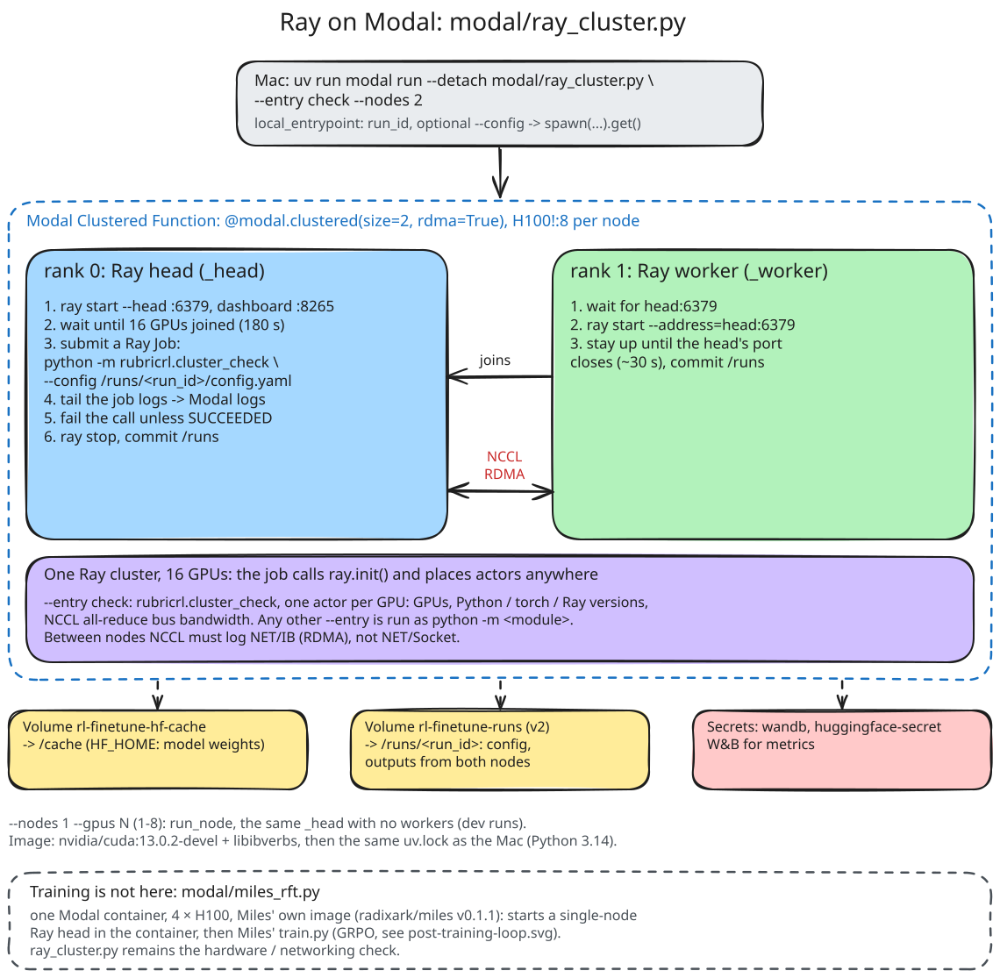

# rl-finetune

**No results yet.** A GRPO trainer written from scratch (`nanorft`), built to answer one
question: if HealthBench's rubric score is the RL reward, does a model get better at
health conversations, or better at the grader? The plan, milestones and design are in
[`PLAN.md`](PLAN.md).

## Layout

| Path | What |
|---|---|
| `src/nanorft/` | The trainer: generator, learner (Tinker-shaped `forward_backward` / `optim_step`), driver, losses. Pure PyTorch, then Ray actors. Subpackages `data/`, `rewards/`, `judge/` and `tracking.py` never import trainer modules |
| `configs/` | Run configs (YAML), from M1 |
| `modal/ray_cluster.py` | Ray clusters on Modal (Modal's multi-node guide): experiments run as Ray Jobs on 1 node (1-8 H100s) or 2 clustered 8-GPU nodes with RDMA |
| `scripts/` | `time_model.py` (step time + memory on this machine), `memory_math.py` (estimates) |
| `docs/training-architecture.md` | How `nanorft` trains, documented as it's built |
| `docs/diagrams/` | Architecture diagrams: `.excalidraw` sources and the rendered SVGs |

## Setup

```bash
uv sync --extra train --extra modal   # Python 3.14, versions pinned by uv.lock
uv run pytest -q
uv run ruff check .
```

## Running

```bash
# Mac (MPS): step time and memory for a candidate model
uv run python scripts/time_model.py --model Qwen/Qwen3.5-0.8B

# Modal: check a Ray cluster (GPUs, NCCL all-reduce bandwidth)
uv run modal run modal/ray_cluster.py --entry check --gpus 8
uv run modal run --detach modal/ray_cluster.py --entry check --nodes 2
```

The Modal image installs from the same `uv.lock` as the Mac. It needs the Modal
secrets `wandb` and `huggingface-secret`.



## Diagrams

Sources are `docs/diagrams/*.excalidraw` (open and edit them on excalidraw.com; the font is
Virgil). Re-render the SVG after an edit; fonts are embedded, so GitHub shows them:

```bash
npx -y mcp-excalidraw-server@2.1.2 render docs/diagrams/ray-on-modal.excalidraw \
    --out docs/diagrams/ray-on-modal.svg
```
