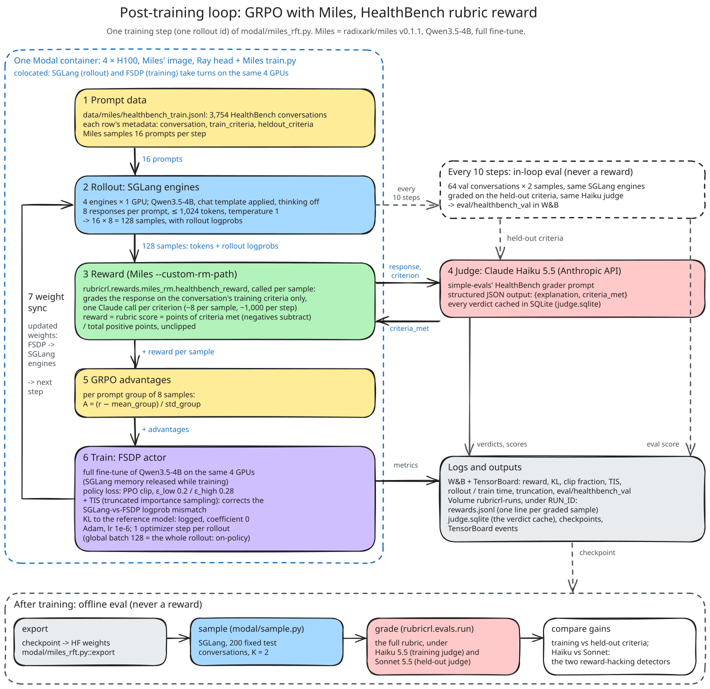
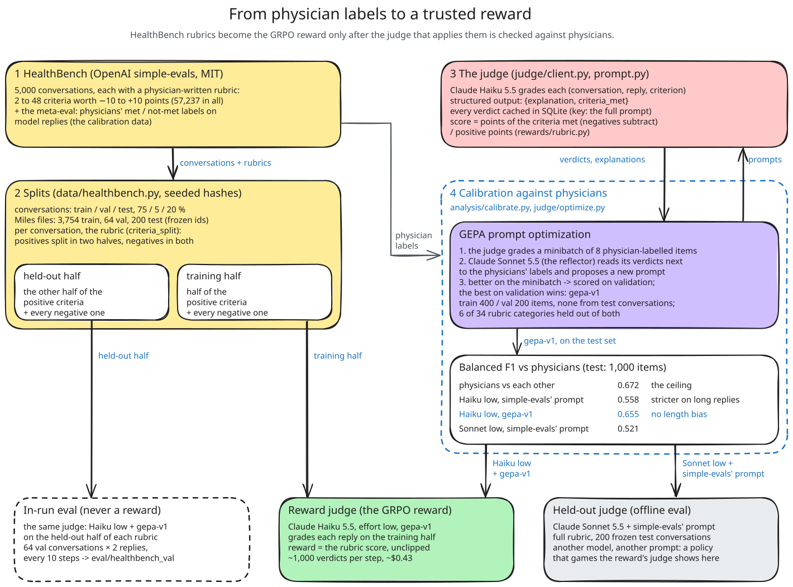
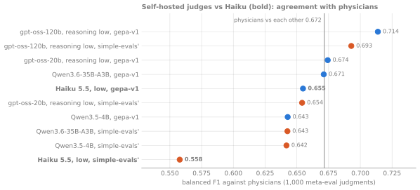
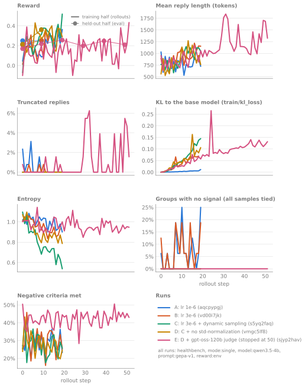
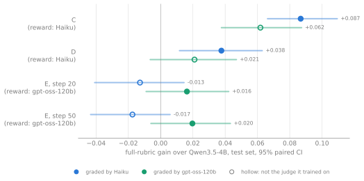

# rl-finetune: HealthBench rubrics as an RL reward

**The question.** HealthBench grades a model's health conversations with an LLM judge,
checking each reply against criteria physicians wrote. If that rubric score is the RL
reward, **does the model get better at health conversations, or learns the grader and
not the task?**

## Hypothesis

A rubric score graded by an LLM judge is a usable RL reward if the judge agrees with
physicians about as well as physicians agree with each other. Training on it then
improves the answers, not just the score.

Three results would show that the policy learned the grader instead. Each is checked
on held-out test conversations:
1. **It gains on the criteria in the reward, but not on held-out criteria** from the
   same rubrics.
2. **It gains under the judge it trained against, but not under a different judge.**
3. **It gains by writing longer replies, not better ones.** HealthBench's rubrics reward
   completeness.

## Setup

| | |
|---|---|
| **Policy** | Qwen3.5-4B, full fine-tune, thinking off |
| **Data** | [HealthBench](https://openai.com/index/healthbench/): 5,000 conversations with physician rubrics, split train / val / test 75 / 5 / 20% by conversation |
| **Reward** | The HealthBench score on a *training half* of each rubric's criteria. The other half is held out for evaluation |
| **Judge** | Claude Haiku 5.5 with a GEPA-optimized prompt (runs A–D), or self-hosted gpt-oss-120b (run E). Both are calibrated against 1,000 physician judgments **before** training |
| **Training** | GRPO (group 8, trunc. importance sampling, β = 0), 16 prompts × 8 replies per step, 20 steps (run E: 50), with [Miles](https://github.com/radixark/miles) on 4 × H100 on [Modal](https://modal.com) |
| **Evaluation** | 200 frozen test conversations, 2 replies each. Paired bootstrap 95% CIs against the base model, on the full rubric and on each half, graded by the training judge and a held-out judge (Sonnet 5.5 with another prompt, or the other of Haiku and gpt-oss) |

## Results in short

- **The best run (C) learned the task.** It gained +0.087 under the judge it trained on,
  and as much on held-out criteria (+0.091). Under Sonnet, a judge it never saw, it gained
  +0.058. Longer replies don't explain the gain. All three checks pass.
- **Part of every gain is the judge's taste.** Each judge credits the policy trained on it
  by about 0.03 more than a second judge does. Check 2 catches this; check 1 can't,
  because a judge's taste applies to every criterion.
- **A better-calibrated judge was not a better reward.** gpt-oss-120b agrees with
  physicians more than Haiku does (0.714 vs 0.655 balanced F1; physicians with each
  other: 0.672). Run E, trained against it, improved on its in-run eval. It showed no
  test-set gain under Haiku (−0.013) and plateaued after step 20.



The full write-up, with every number's source, is [`docs/report.md`](docs/report.md).
Every training and calibration run is public in W&B
([`rl-finetune`](https://forge.coreweave.com/wandb/marcandregeraldo-none/rl-finetune)).
So are the [Weave traces](https://forge.coreweave.com/wandb/marcandregeraldo-none/rl-finetune/weave/traces):
one per judge verdict and per environment episode, with the conversation, the reply, the
criterion and the judge's explanation.

## The task

Each HealthBench conversation has a physician rubric of 2 to 48 criteria worth −10 to
+10 points. The policy writes the next assistant reply. A judge checks every criterion as
met or not met, and the score is the points met over the positive points available.

- **Reward:** the score on the *training half* of each conversation's criteria.
- **Held-out half:** the other half of the positive criteria, never seen by the reward.
  Negative criteria are in both halves, so harm is always penalised.
- **Test set:** 200 test conversations, frozen in [`data/eval_ids.txt`](data/eval_ids.txt).
- **Environment:** an [OpenEnv](https://github.com/huggingface/openenv) server, either a
  single reply or a simulated patient over several turns (report §5).



## Step 1: calibrate the judge before training

A reward is only as good as its grader. On 1,000 physician judgments from HealthBench's
meta-eval, each judge's verdicts are scored against the physicians' with balanced F1
(the mean of F1 on "met" and on "not met"). Physicians scored against each other set
the ceiling. Test-retest κ measures how much the verdicts change when the same items
are graded twice.

| Judge | Prompt | Balanced F1 | Retest κ |
|---|---|---|---|
| Physicians vs each other | | 0.672 | |
| Claude Haiku 5.5 | simple-evals' | 0.558 | 0.60 |
| **Claude Haiku 5.5** (reward for runs A–D) | **`gepa-v1`**, GEPA-optimized | **0.655** | 0.74 |
| **gpt-oss-120b**, self-hosted (reward for run E) | `gepa-v1` | **0.714** | 0.87 |
| Qwen3.6-35B-A3B, self-hosted | `gepa-v1` | 0.671 | 1.00 |

- **The prompt.** [GEPA](https://github.com/gepa-ai/gepa) rewrote the grader prompt
  against physician labels. Training and validation used conversations disjoint from the
  test set, and 6 rubric categories were held out entirely.
- **Length bias.** With simple-evals' prompt, Haiku said "met" less often the longer the
  reply (0.53 → 0.30 from the shortest to the longest quartile). `gepa-v1` is flat
  (0.68 → 0.68), so the reward doesn't penalise length.
- **Report sections:** §4, §4.1 and §4.2.



## Step 2: the policy's baseline

- **Qwen3.5-4B scores 0.500** under the reward's judge on the test set.
- **Physicians' own ideal answers score 0.211**, under simple-evals' prompt.
- **The model's replies are 2.4× longer.** The rubrics reward completeness, which is the
  obvious direction for GRPO to exploit. That is why the evaluation checks length (report §7).

## Step 3: GRPO with Miles on Modal

**Setup:**
- [Miles](https://github.com/radixark/miles) v0.1.1, adapted from Modal's `miles_grpo`
  example.
- FSDP, with SGLang colocated on 4 × H100.
- An in-run eval on 64 validation prompts, graded on the **held-out** half.

Container layout: [`docs/training-architecture.md`](docs/training-architecture.md).

| Run | Change | In-run eval, held-out half | Test gain, Haiku | Test gain, gpt-oss-120b |
|---|---|---|---|---|
| A | lr 1e-6 | 0.250 → 0.310 | +0.031 | |
| B | lr 3e-6 | 0.207 → 0.255 (step 10; checkpoint lost) | | |
| **C** | B + dynamic sampling | 0.215 → **0.442** | **+0.087** | **+0.062** |
| D | C + no std-normalization | 0.215 → 0.382 | +0.038 | +0.021 |
| E | D, judged by gpt-oss-120b, 50 steps | 0.170 → 0.256 (step 20) → 0.210 | −0.013 / −0.017 | +0.016 / +0.020 |

- **Steps:** runs A–D trained for 20 steps.
- **Test gains:** paired by conversation, over the base model, on the full rubric. For E,
  the two values are steps 20 and 50.
- **E's in-run eval:** graded by gpt-oss, so its levels can't be compared with A–D's.
- **Cost:** about $8–11 of GPU per 20-step run, plus $9–16 of Haiku verdicts. Run E cost
  about $66 of GPU and no API spend.



## What happened

- **C improved on the task, not just on the grader.** Both hacking detectors stay quiet:
  the gain on held-out criteria matches the gain on trained ones, and it holds under
  Sonnet. Its replies grew 31%, but given the same conversation, neither judge scores the
  longer of two replies higher (§7.2). The gain sits in completeness and context
  awareness.
- **Dynamic sampling was the lever.** It refills the batch with groups that have signal.
  At the same learning rate, it took B's KL 0.069 to C's 0.145, and C's entropy fell from
  1.10 to 0.54 (§6.2).
- **D was calmer and learned less.** It removed std-normalization from the advantage: the
  maximum grad norm fell from 14.8 to 4.8, and the test gain fell from +0.087 to +0.038.
- **Each judge favours its own policy by ~0.03** (see the figure below). C looks better
  under Haiku, E under gpt-oss. Held-out criteria can't catch this, because a judge's taste
  applies to every criterion (§8).
- **E plateaued.** From step 20 to step 50, the test score didn't move under either
  judge. Replies grew 12%, and Haiku's communication-quality axis fell 0.657 → 0.600 →
  0.527 (§6.4, §7.1).
- **Two silent infrastructure bugs:**
  - Miles' checkpoint converter saved random weights without an error (1 of 724 tensors
    matched). Exports now fail on a missing tensor and are compared with the base weights.
  - An NCCL error lost B's only checkpoint (§6.2).
- **One open question.** Under gpt-oss, E's test gain sits on the held-out half, not the
  trained half: the reverse of reward hacking (§7.1).



## Reproduce

```bash
uv sync --extra train --extra modal --extra observe --extra env   # Python 3.14, uv.lock
uv run pytest -q

uv run python -m rubricrl.data.healthbench download                # pinned by sha256
uv run python -m rubricrl.analysis.calibrate run --n 1000          # the judge vs physicians
uv run modal run modal/miles_rft.py::main --smoke-test             # 2 GRPO steps
uv run modal run --detach modal/miles_rft.py::main --num-rollout 20 --lr 3e-6 --dynamic-sampling
uv run modal run modal/miles_rft.py::export --run-id RUN_ID
uv run modal run modal/sample.py --model qwen3.5-4b --checkpoint RUN_ID/huggingface/iter_0000020 --name rft-20
uv run python -m rubricrl.evals.run score runs/samples/rft-20.jsonl
uv run python -m rubricrl.evals.run compare runs/evals/qwen3.5-4b runs/evals/rft-20
```

**Needs:**
- the API keys `ANTHROPIC_API_KEY` and `WANDB_API_KEY`;
- the Modal secrets `anthropic`, `wandb` and `huggingface-secret`.

Every verdict is cached in SQLite, so reruns are free. Each module's docstring lists its
commands; the self-hosted judge is in
[`docs/self-hosted-judge/`](docs/self-hosted-judge/README.md).

## Layout

| Path | What |
|---|---|
| `src/rubricrl/data/` | HealthBench download, splits, the Miles export ([`data/README.md`](data/README.md)) |
| `src/rubricrl/judge/` | The grader prompts (simple-evals', `gepa-v1`), the Claude and self-hosted judges, GEPA |
| `src/rubricrl/rewards/` | The HealthBench score; the Miles reward function and logging hooks |
| `src/rubricrl/analysis/` | Calibration against physicians; the figures |
| `src/rubricrl/env/`, `sim/` | The OpenEnv environment; the simulated patient and its checks |
| `src/rubricrl/evals/` | Scoring under several judges, bootstrap CIs, paired comparisons |
| `modal/miles_rft.py` | GRPO with Miles on Modal, export, the self-hosted judge |
| `modal/sample.py`, `calibrate.py`, `optimize.py` | Sampling checkpoints; calibration and GEPA on Modal |
| `docs/` | [The report](docs/report.md), [training architecture](docs/training-architecture.md), [diagrams](docs/diagrams/README.md), [a Megatron LoRA plan](docs/megatron-lora/README.md) |

## Credits

- **HealthBench** data and grader prompt: OpenAI's
  [simple-evals](https://github.com/openai/simple-evals), MIT.
- **The Miles recipe on Modal:**
  [modal-examples `14_clusters/miles_grpo.py`](https://github.com/modal-labs/modal-examples), MIT.
- **Licence:** MIT ([`LICENSE`](LICENSE)).
