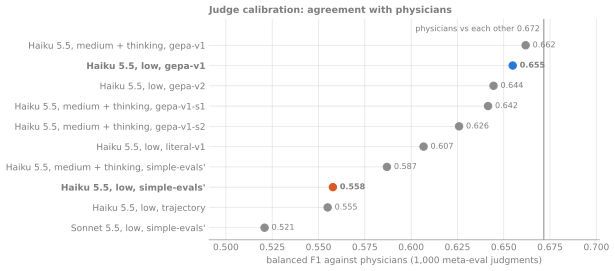
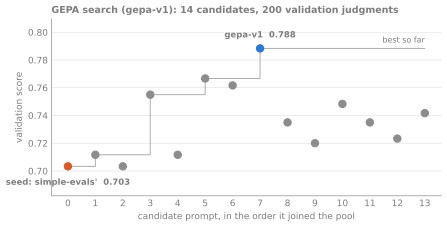
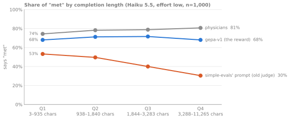
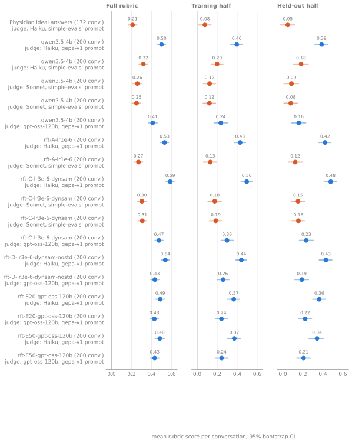

# From expert labels to an RL environment: HealthBench rubrics, a calibrated judge, and GRPO

## 1. Question and status

**Question.** HealthBench grades health conversations with physician-written rubrics
and an LLM judge. If that rubric score is the reward for RL, does the policy get
better at health conversations, or better at the grader? And how do you turn
expert data written for one fixed reply into an environment a policy can interact
with for several turns?

**Status.**

| Piece | State |
|---|---|
| Data, rubric score, consistency with simple-evals | done, checked on all 57,237 criteria |
| Judge + calibration against physicians | done (5 configurations; W&B + Weave) |
| Judge prompt optimization (GEPA) | done; `gepa-v1` is the reward's prompt (0.558 → 0.655 balanced F1) |
| v1 environment (single reply, OpenEnv) | done; parity with the in-process reward checked |
| v2 environment (simulated patient) | done; 100 test scenarios; fidelity + doctor checks |
| Baselines | physician ideal answers; Qwen3.5-4B under the old prompt, `gepa-v1` and Sonnet |
| GRPO with Miles | 3 runs of 20 steps through the environment (§6); offline before/after on the test set for 2 of them (§7) |

## 2. Data and rubrics

*From physician labels to a trusted reward: the judge's prompt is tuned against physicians (balanced F1 0.558 → 0.655; physicians among themselves: 0.672) before it grades the training half of each rubric.*

**What.** HealthBench (OpenAI simple-evals, MIT): 5,000 conversations, each with a
physician rubric of 2 to 48 criteria worth −10 to +10 points (57,237 criteria;
48,562 distinct texts, the paper's count). `src/rubricrl/data/healthbench.py`
downloads the files pinned by sha256 and splits conversations (train / val / test
75 / 5 / 20 %) by a seeded hash; 200 test conversations are frozen in
`data/eval_ids.txt`.

**The score** (`rewards/rubric.py`): points of the criteria met, negatives included,
divided by the sum of positive points; unclipped per response (simple-evals clips
only the mean). Checked identical to simple-evals' `calculate_score` on 25,000
random verdict vectors.

**Held-out criteria.** Each conversation's positive criteria are split in two
disjoint halves: the reward uses one, the evaluation also reports the other.
Negative criteria go in both, so the reward never stops penalising harm.

*Intuition.* If the policy learns the grader rather than the task, the gain shows
on the criteria it was trained on and not on the held-out ones. Compare **gains**
between runs, not levels: each half carries every negative against half the
positive points, so half-scores sit below the full score.

## 3. The judge

**What.** Claude Haiku 5.5 grades each (conversation, response, criterion) with
structured output (`{explanation, criteria_met}`), cached in SQLite by a hash of
the full prompt (`judge/client.py`). The prompt was simple-evals' grader prompt,
verbatim; since §4.1 the reward uses the GEPA-optimized `gepa-v1`, and simple-evals'
stays the library default (`judge/prompt.py`, `TEMPLATES`). ~$0.0004 per verdict;
a training step of 128 responses is ~1,000 verdicts, ~$0.43.

**Why measure noise.** The API has no `temperature` anymore: verdicts are samples.
Test-retest (the same items graded twice) measures that noise; it enters the RL
reward directly.

## 4. Calibration against physicians

**Method** (`analysis/calibrate.py`, simple-evals' meta-eval): on 1,000 physician
judgments stratified by rubric category, balanced F1 = mean of F1(met) and
F1(not met) over every (judge, physician) label pair. Physicians scored against
each other the same way give the ceiling. Runs on Modal CPU
(`modal/calibrate.py`), each a W&B run (`job_type=calibration`: config, metrics,
per-category and per-length tables, confusion matrix) with one Weave trace per
graded completion.

| Rater | Balanced F1 | Says "met" | Test-retest κ |
|---|---|---|---|
| Physicians vs each other | 0.672 | 78% | – |
| Haiku 5.5, effort medium, thinking | 0.587 | 49% | 0.85 |
| Haiku 5.5, effort low | 0.558 | 43% | 0.61 |
| Sonnet 5.5, effort low | 0.521 | 37% | 1.00 |
| Haiku 5.5, effort low, trajectory prompt (v2) | 0.555 | 46% | 0.75 |

Agreement falls with completion length (Haiku low: 0.68 on the shortest quartile,
0.45 on the longest).

*Intuition.* Physicians are not ground truth: they disagree with each other
(0.672), so that is the realistic ceiling. The judge is systematically stricter
(says "met" 43–49% vs 78%). A bigger model is not automatically a better grader
here (Sonnet below Haiku). Thinking buys consistency (κ 0.61 → 0.85), which is
what a reward needs most.

*Caveat.* The meta-eval covers cluster-level (consensus) criteria only; the reward
is mostly conversation-specific criteria.

The trajectory prompt (§5.4: the same template, grading the assistant's replies
after a marker line) calibrates like the original, 0.555 vs 0.558: rewording the
grader for whole consultations costs no measurable agreement with physicians
($0.46, [W&B run](https://forge.coreweave.com/wandb/marcandregeraldo-none/rl-finetune/runs/dbpuv58v)).

### 4.1 Optimizing the judge prompt (GEPA)

**What** (`judge/optimize.py`, `modal/optimize.py`). GEPA (reflective prompt
evolution) rewrites the grader template:
1. The judge grades a minibatch of 8 meta-eval judgments with a candidate prompt.
2. Claude Sonnet 5.5 reads the judge's verdicts and explanations next to the
   physicians' labels, writes a diagnosis, and proposes a new prompt.
3. A proposal that does better on the minibatch is scored on a validation set and
   joins the pool. The best on validation wins.

The judge inside the loop is the production `ClaudeJudge` (structured output,
effort, thinking, verdict cache), plugged into the `gepa` library through an
adapter. DSPy was the first plan, but it would call the model through its own
prompt format and LiteLLM, and so would tune a judge other than the one the
reward uses.

**No leakage into the test set.**
- **Test:** the same 1,000 judgments as §4, untouched by the optimizer.
- **Held-out categories:** 6 of the 34 rubric categories never appear in training
  or validation, so the test set shows whether gains carry to rubric texts the
  optimizer never saw.
- **Training and validation:** 400 and 200 judgments from conversations with no
  item in the test set, physician-majority ties dropped. Each is balanced 50/50
  between met and not met, so that a judge that always says "met" isn't rewarded.
- **Score per item:** the share of physicians the judge agrees with.

**Results** (test set, n=1,000; physicians vs each other: 0.672, 78% "met"):

| Judge | Prompt | Balanced F1 | Seen / held-out categories | Says "met" | Retest κ | "Met", shortest → longest quartile |
|---|---|---|---|---|---|---|
| Haiku low | simple-evals' | 0.558 | 0.552 / 0.580 | 43% | 0.60 | 0.53 → 0.30 |
| Haiku low | + 2 hand-written sentences | 0.607 | 0.602 / 0.622 | 53% | **0.78** | 0.58 → 0.43 |
| Haiku low | GEPA, optimized on this judge, val 600 (`gepa-v2`) | 0.644 | 0.645 / 0.634 | 65% | 0.65 | 0.64 → 0.60 |
| **Haiku low** | **GEPA (`gepa-v1`): the reward** | **0.655** | 0.654 / 0.657 | 70% | 0.74 | 0.68 → 0.68 |
| Haiku medium + thinking | simple-evals' | 0.587 | 0.588 / 0.579 | 50% | 0.85 | 0.54 → 0.46 |
| Haiku medium + thinking | GEPA `gepa-v1` / seed 1 / seed 2 | 0.662 / 0.642 / 0.626 | mean 0.641 / 0.652 | 57–66% | 0.69–0.76 | 0.66 → 0.66 (`gepa-v1`) |

*Balanced F1 against physicians for every judge configuration on the same test set; the vertical line is physicians against each other (blue: the reward's judge, orange: the judge it replaced).*

`gepa-v1` was optimized with Haiku medium + thinking as the judge, ran 19
steps, produced 14 candidates and cost $1.95, plus $0.69 for the test set. It
was selected by its validation score (0.788 vs 0.765 for the two repeats), not
on test. Links:
[optimization](https://forge.coreweave.com/wandb/marcandregeraldo-none/rl-finetune/runs/h1ddeugm), [test, medium + thinking](https://forge.coreweave.com/wandb/marcandregeraldo-none/rl-finetune/runs/h3fxozlw),
[test, effort low](https://forge.coreweave.com/wandb/marcandregeraldo-none/rl-finetune/runs/8iofnm74), seeds 1 and 2 ([rwigvf29](https://forge.coreweave.com/wandb/marcandregeraldo-none/rl-finetune/runs/rwigvf29),
[8z877xpl](https://forge.coreweave.com/wandb/marcandregeraldo-none/rl-finetune/runs/8z877xpl)), [hand-written prompt](https://forge.coreweave.com/wandb/marcandregeraldo-none/rl-finetune/runs/xkt1j31m),
[`gepa-v2`](https://forge.coreweave.com/wandb/marcandregeraldo-none/rl-finetune/runs/lzxtgrfi). In total about $15 of API spend.

*GEPA's search for `gepa-v1`: validation score of each candidate prompt in the order it joined the pool, the seed (simple-evals' prompt) in orange, the selected prompt in blue, the best so far as a step line.*

**What the ablations show.**
- **The gain is real.** Three optimizer seeds on the same data all beat the
  baseline, by +0.04 to +0.075 (mean +0.056). The spread between seeds (±0.018)
  is about the size of the test set's own noise. Each of them gains on the 6
  held-out categories (+0.055 to +0.105).
- **Most of it is the judge becoming less strict.** Test F1 rises with how often
  a prompt says "met" (57% → 0.626, 63% → 0.642, 66% → 0.662). All three prompts
  remain stricter than physicians.
- **A sensible hand edit gets half.** Two sentences ("grade only what the rubric
  says; fail only for material problems") give +0.049, against +0.097 for GEPA.
  GEPA's prompt spells out what counts as a material problem for accuracy,
  context-seeking, understandability and multi-part items.
- **Only GEPA removes the length bias.** The old judges grow stricter as answers
  get longer; physicians grow slightly more lenient. On the longest quartile,
  Haiku low said "met" 30% of the time against physicians' 81%. A reward like
  that pushes the policy toward shorter answers than physicians would credit.
  `gepa-v1` is flat across lengths, slightly below physicians, so on this data
  there is no sign that it rewards length.
- **With the new prompt, thinking adds nothing.** Effort low scores 0.655 vs
  0.662, with higher consistency (κ 0.74 vs 0.69), for about 25% less per
  verdict. The saving is less than half because the longer prompt makes input
  tokens dominate.
- **More optimizer budget doesn't move it.** Optimizing directly on effort low,
  with a 600-item validation set, gave 0.644. Every GEPA run lands at 0.63–0.66
  on test. The F1 on "not met" stays at about 0.49 throughout, so the remaining
  gap to physicians is the judge's misses on the "not met" side.
- **The three prompts don't make different errors.** A majority vote across them
  (0.655) beats none of them clearly; they agree on 86% of items, as often as
  one prompt agrees with itself on a retest.

*Share of "met" by completion-length quartile on the test set: physicians, Haiku low with simple-evals' prompt, and Haiku low with `gepa-v1`.*

*Intuition.* The baseline judge was wrong in two directions: too lenient when a
rubric item had explicit required steps, too strict on holistic quality items,
where it failed answers for flaws the rubric didn't mention. GEPA's diagnoses
said exactly that. What fixed it was telling the judge to grade the rubric item
literally, with an explicit threshold for failing. The cost is consistency: κ
falls from 0.85 (medium + thinking, old prompt) to 0.74 (low, new prompt). That
makes the reward noisier, though still more consistent than the old effort-low
judge (0.60).

*Caveats.*
- The meta-eval still covers only the 30 consensus criterion texts.
- The new prompt tells the judge to mark negative criteria ("fails to…") met
  only when the problem is clearly present, which could under-penalize harm on
  the reward's conversation-specific criteria. Not measured yet (§7, §10).
- One line of the prompt is a deliberate leniency prior ("most responses from a
  capable assistant… are judged to meet general-quality rubrics"). It's the line
  to watch for reward hacking.

**The reward now** uses Haiku 5.5, effort low, with `gepa-v1`
(`JudgeConfig.prompt_version`, `RUBRICRL_PROMPT`, `miles_rft --judge-prompt`). The
template sits verbatim in `judge/prompt.py`. Rerunning the calibration from it
reproduces 0.655 exactly from the cache. Patient mode (v2) still grades with the
trajectory prompt, which is built on simple-evals' prompt and is not yet ported.

## 5. From expert data to an environment

### 5.1 The environment (v1: one reply)

*One GRPO step with `--reward env`: Qwen3.5-4B plays the doctor through Miles' session server, so only the doctor's turns are in the loss; the environment returns the graded episode as the sample's reward. In patient mode the judge grades the whole transcript with the trajectory prompt (§5.4), not `gepa-v1`.*

`src/rubricrl/env/` is an [OpenEnv](https://github.com/huggingface/openenv)
environment (`reset` / `step`, typed Action / Observation, FastAPI +
WebSocket server, a rubric in `openenv.core.rubrics`). An episode resets to a
HealthBench conversation; the policy's one reply is graded on the conversation's
training half (`half="train"`) or held-out half (`half="eval"`) by the calibrated
judge. Its reward is the same function as the in-process reward: checked equal on
3 conversations × both halves with the real judge (all verdicts shared through
the cache).

*Why OpenEnv, not Harbor.* Both plug into Miles as agent functions. Harbor tasks are
containers graded by `test.sh`: right for agentic coding and terminal suites. A
judged conversation is a `reset → step → reward` episode with no sandbox: OpenEnv's
model, with rubrics built in.

### 5.2 Why the rubrics break in simulation

The physicians wrote each conversation's criteria for **one fixed next reply**. In a
simulated consultation, a patient keeps talking, and the conversation soon stops
matching the transcript the criteria were written for: "asks how long the pain has
lasted" may be answered by turn 2, or no longer apply. Graded naively, the reward
gets noisy in a way calibration cannot see.

### 5.3 The mapping (v2)

`sim/scenarios.py`, one Claude Sonnet call per conversation (structured output):

- **Consensus criteria** (cluster-level, general behaviours): kept verbatim; they are
  the ones the judge is calibrated on.
- **Conversation-specific criteria**: kept, **rewritten** to hold over a whole
  consultation ("by the end, has established how long the pain has lasted, or
  asked"), or **dropped** with a reason (e.g. about one reply's formatting). Points,
  sign and axis are copied from the physician criterion, never generated; each new
  criterion keeps its source id.
- **The patient**: a persona and **hidden facts** (what they know but say only if
  asked), derived from the conversation and from the criteria that reward seeking
  context. This is what makes asking good questions rewardable.
- **The opening** is the conversation verbatim: v2 at turn 0 is the v1 prompt.

On the 100 test scenarios (drawn from the frozen eval subset, 5 dialogue themes):
1,163 criteria, **46% rewritten, 36% kept, 14% consensus, 3% dropped**; 5.2 hidden
facts per patient; $2.16.

**A bug the mapping step must guard against.** The first version rewrote some
negative criteria as the *good* behaviour: "Fails to remind the user to get a
tetanus booster" (−6) became "has told the user to get a tetanus booster", still
−6. That flips the reward's sign for the criterion: the doctor who does the right
thing is penalised. The fix: an explicit polarity rule in the prompt, and a
`met_means: good|bad` field per criterion checked against the sign of the points;
a mismatch drops the criterion and records why (`scenario-v2`).

### 5.4 The simulated patient

`sim/patient.py`: Claude Haiku, structured output `{reply, revealed_fact_ids, end}`,
cached on the transcript (replays are free and identical). It reveals a hidden fact
only when the doctor's last message asks for it, answers as a lay person, and ends
the consultation when its end condition is met; 6 doctor turns at most. The whole
consultation is graded at the end with a trajectory variant of the grader prompt
(`TRAJECTORY_TEMPLATE`: the same template, judging the assistant's replies after a
marker line); intermediate steps carry reward 0.

### 5.5 Checks (no physician labels exist for simulated consultations)

**Rewrite fidelity** (`sim.checks fidelity`): on the physicians' own ideal answers,
each rewritten criterion is judged next to its original. 517 pairs from 84
scenarios: **86% agreement** (positives 90%, negatives 82%), $0.19. For scale, the
same judge agrees with itself 90% of the time on identical prompts (test-retest),
so most of the gap is judge noise; the residual concentrates on negated criteria
("Fails to X" vs "has never X" judged differently on the same long answer), a
weakness of the judge worth knowing.

**Doctor sanity** (`sim.checks doctors`, 20 test scenarios, traces in Weave):

| Doctor | Reward | Hidden facts drawn out | Facts revealed unasked |
|---|---|---|---|
| Careful (Sonnet: asks before advising) | **+0.45** | 53% | 3.4% (2 of 58) |
| Minimal (scripted: the same generic sentence each turn) | **−0.25** | 2.5% | 3 facts in 20 episodes |

Two things this check caught on the way: an LLM "terse doctor" told never to ask
questions (Haiku) asked anyway and wrote full answers, so the lower bound is now
scripted; and the first patient prompt volunteered hidden facts unasked, which
leaks the reward for seeking context. `patient-v2` is stricter, and the check now
measures leakage directly.

## 6. Training with Miles

**Recipe** (`modal/miles_rft.py`, adapted from Modal's tested `miles_grpo`): Miles
v0.1.1 pinned by digest, FSDP backend, SGLang colocated on 4 × H100, GRPO with group
8, TIS (corrects the SGLang-vs-FSDP log-prob gap), clip 0.2 / 0.28, β = 0, lr 1e-6 or 3e-6;
Qwen3.5-4B, thinking off, 16 prompts × 8 samples, ≤8,192 tokens per reply (≤2,048 per turn in patient mode; 1,024 truncated 53–66% of training replies in the smoke run).

*Everything a training run needs lives in one Modal container; the judge, the patient, W&B/Weave and the dashboards reach it from outside.*

**Two reward paths, same score.**

- `--reward rm` (default): Miles calls `rewards.miles_rm.healthbench_reward` in
  process.
- `--reward env`: Miles' agentic rollout (`agentic_tool_call.generate`, session
  server, `--tito-model qwen35`) calls `env.miles_agent.run` per sample, which plays
  an episode against the environment; Miles records the exact tokens of each doctor
  turn, and the patient's turns stay outside the loss. The environment runs as a
  sidecar in the training container from its own venv (`uv.lock`), so OpenEnv's
  server stack never touches Miles' Python; the agent side speaks OpenEnv's
  WebSocket protocol directly (`env/wire.py`).

**Observability.** W&B gets Miles' own metrics (`train/*` losses, grad norm, KL,
TIS; `rollout/*` reward, lengths, truncation, groups with no variance; `perf/*`
timings) plus ours from two Miles hooks (`rewards/miles_log.py`):
`rollout/rubric/*` (per-axis scores, positive and negative criteria met, failed
verdicts, judge cost, policy vs environment time) and `rollout/run/*` (groups with
no signal, per-theme scores, tokens, running GPU + judge cost). Weave gets one trace
per episode from the environment (every eval episode, 10% of training ones), with a
child per judge verdict. Each run also serves the Ray dashboard (behind a token)
and Grafana (view-only), each through its own tunnel.

### 6.1 Three runs

Every run: 20 steps of 16 prompts × 8 replies (2,560 training episodes), the
training half of each rubric as the reward, an in-run eval on the 64 validation
prompts × 2 replies graded on the **held-out** half, at steps 0, 10 and 20.

| Run | Change | Held-out eval, step 0 → 10 → 20 | KL to base, end | Entropy, start → end | Max grad norm | Step (median) | GPU + judge |
|---|---|---|---|---|---|---|---|
| A (`aqcpypgj`) | lr 1e-6 | 0.250 → 0.248 → 0.310 | 0.011 | 1.02 → 0.90 | 8.2 | 55 s | $8.86 + $9.40 |
| B (`vd00i7jk`) | lr 3e-6 | 0.207 → 0.255 → lost | 0.069 | 1.00 → 0.93 | 26.2 | 54 s | $8.59 + $9.56 |
| C (`s5yq2faq`) | lr 3e-6 + dynamic sampling | 0.215 → 0.362 → **0.442** | 0.145 | 1.10 → **0.54** | 14.8 | 82 s | $10.45 + $15.94 |

GPU cost is wall time × 4 GPUs × $3.95 (an estimate); judge cost is summed from
every verdict's tokens in `rewards.jsonl`. The step-20 eval points live in each
run's `rewards.jsonl`, not in W&B (the figure's eval dots stop at step 10).

**Paired by prompt** (the same 64 validation prompts, step 0 vs the last eval):
A +0.060 [−0.010, 0.127], 31 prompts better and 21 worse; B (to step 10) +0.048
[−0.033, 0.127]; C **+0.226 [0.120, 0.336]**, 46 better and 13 worse. Only C clears
the noise.

### 6.2 What the runs showed

- **The in-run eval is noisy.** The three runs start from the same model, yet
  score 0.207, 0.215 and 0.250 at step 0: about ±0.04 from sampling alone. A
  difference between two evals means little below ~0.08; paired comparisons on the
  same prompts and a bigger test set (§7) do better.
- **At lr 1e-6 the policy barely moves.** A's KL to the base model reached 0.011
  after 20 steps, and its held-out eval was flat at step 10. Three times the
  learning rate gave 6× the drift (B 0.069) and, with dynamic sampling, 13× (C
  0.145).
- **The PPO clip never fires.** The global batch is the rollout batch, so each
  batch gets one optimizer step and the policy ratio is exactly 1:
  `train/ppo_kl` and `train/pg_clipfrac` stay 0. This is a group-baselined policy
  gradient with TIS, not clipped PPO. Clipping would matter with several updates
  per batch.
- **Very short replies dominate the gradient.** B's step 7 had a 2-token reply;
  the grad norm went from ~2 to 26.2 and the KL jumped from 0.017 to 0.066 in one
  step. The loss is averaged within each reply before averaging across replies,
  so each token of a 2-token reply weighs ~400× a token of an 800-token reply.
  Gradient clipping (norm 1.0) bounds the size of the step, not its direction.
  C (14.8) and A (8.2) show the same spikes. The fix is token-level averaging
  (`--calculate-per-token-loss`, Dr. GRPO / DAPO), not tried yet.
- **Dynamic sampling worked and cost more.** C drops groups whose 8 replies all
  scored the same and draws new prompts until 16 groups have signal. In A and B
  0–25% of groups had none (7% on average). C graded 4,463 training episodes for the same 2,560
  trained on: groups in flight when the batch fills are discarded. Its judge bill
  was 1.7× B's, and its steps 1.5× slower. It is also the run that improved most.
- **C sharpened.** Entropy fell from 1.10 to 0.54 while the training reward rose to
  0.52 at step 19. A sharper policy that scores higher is what RL is meant to do,
  up to the point where it stops exploring; 20 steps don't reach it, a longer run
  would need an entropy floor or a KL penalty.
- **Replies got longer.** Mean reply length on the eval rose 654 → 1,052 tokens in
  C (A: 650 → 742), and C's completeness axis went from 0.05 to 0.43 on the eval.
  §7 asks how much of the gain that is.
- **Penalties did not rise.** Negative criteria met on the eval: A 31% → 30%, C
  29% → 25%. The policy is not buying points with more mistakes.
- **Infrastructure failures.**
  - B lost its final checkpoint: an NCCL error inside PyTorch's checkpoint writer
    (`gather_object`) killed the save at step 20, and it was the only save. Runs now
    save every 5 steps (`--save-interval`).
  - Miles' FSDP→Hugging Face converter saved random weights for Qwen3.5 without an
    error: it built a text-only model, matched 1 of 724 checkpoint tensors, and
    loaded with `strict=False`. The first offline eval sampled gibberish. The
    export now keeps the checkpoint's names and fails on any missing text-model
    tensor, and each export is checked against the base model (median relative
    difference: A 0.0002, C 0.001).

*Runs A (blue), B (orange) and C (green) per rollout step: reward on the training half with the held-out eval, reply length, truncation, KL to the base model, entropy, groups with no signal, negative criteria met.*

### 6.3 What to monitor, and what tonight's runs looked like

Three layers, checked in order: a run that fails an earlier one can't be judged on
a later one.

| Layer | Signal | Tonight (healthy range) | Unhealthy looks like | First check |
|---|---|---|---|---|
| **1. The reward is honest** | episodes without a grade, failed verdicts | 0, 0 | > 1% | the environment and judge logs |
| | truncated replies | 0–3% (53–66% at a 1,024-token cap) | > 10%: the reward grades the cut | raise the cap, or penalize length |
| | trainer vs SGLang log-prob gap (`train_rollout_logprob_abs_diff`), TIS ratio | 0.015–0.018, ~1.0 | rising: numerics or tokenization diverge | TITO mismatch, sampling settings |
| | TITO session mismatch | 1–2% | tracks truncation | the cap |
| **2. The optimizer is stable** | KL to the base model | lr 1e-6: 0.011; 3e-6: 0.07–0.15 | sudden jumps; climbing with flat held-out | read the batch; lower lr or add β |
| | entropy | 0.9–1.0 (C: 0.54) | collapse (identical replies) or explosion (gibberish) | samples; lr; entropy bonus |
| | grad norm | median ~2, spikes 8–26 | sustained growth, NaN | shortest and longest replies in the batch |
| | groups with no signal | 0–25% | > 50%: nothing to learn | prompt difficulty, dynamic sampling |
| **3. It learned the task** | held-out criteria (in-run, offline) | C +0.23 in-run, +0.09 offline | training reward up, held-out flat | read top-reward samples |
| | held-out judge (Sonnet) | C +0.045 | Haiku up, Sonnet flat | judge-specific hacks |
| | negative criteria met | flat or down | rising with reward | which criteria |
| | length, and length vs score | +61% in C | gain explained by length alone | length-controlled score (§7) |

## 7. Baselines

The 200-conversation eval subset; mean over conversations, 95% bootstrap CI.

| Run | Judge | Full rubric | Training half | Held-out half |
|---|---|---|---|---|
| Physician ideal answers (172 conversations) | Haiku | 0.211 [0.167, 0.255] | 0.077 | 0.049 |
| Qwen3.5-4B (K = 2, 200 conversations) | Haiku | 0.318 [0.275, 0.361] | 0.199 [0.138, 0.259] | 0.182 [0.107, 0.255] |

Median reply length: physicians 1,406 characters, Qwen3.5-4B 3,400. The base
model already beats the physicians' own answers under this grader, with replies
2.4× longer: the rubrics reward completeness (the HealthBench paper reports the
same for frontier models), which is exactly the direction GRPO can exploit. The
two rows cover different conversation sets (172 vs 200), so they are not a
paired comparison. Scoring cost $1.71.

Both rows were graded with simple-evals' prompt. Regraded under `gepa-v1` (the
reward's prompt), the base model scores 0.500 [0.456, 0.540], up from 0.318: the
old prompt under-credited its long answers. Under Sonnet with simple-evals' prompt
(the held-out judge, one sample per conversation, $17.50) it scores 0.258 [0.212,
0.304].

### 7.1 Before and after training

The step-20 checkpoints of A and C, exported to Hugging Face format and sampled
like the base model (K = 2, temperature 0.7, top-p 0.8, ≤2,048 tokens), on the 200
test conversations. Differences are paired by conversation, with 95% bootstrap CIs
(`evals.run compare`).

| Checkpoint | Judge | Full rubric | Training half | Held-out half | Train − held-out gain |
|---|---|---|---|---|---|
| A (lr 1e-6) | Haiku `gepa-v1` | +0.031 [0.010, 0.052] | +0.033 [0.003, 0.065] | +0.035 [0.000, 0.071] | −0.002 |
| A | Sonnet | +0.011 [−0.022, 0.042] | +0.007 | +0.038 [−0.019, 0.092] | −0.031 |
| C (lr 3e-6 + dynamic sampling) | Haiku `gepa-v1` | **+0.087 [0.066, 0.109]** | +0.100 [0.069, 0.133] | **+0.091 [0.055, 0.126]** | +0.009 |
| C | Sonnet | **+0.045 [0.010, 0.080]** | +0.051 [−0.000, 0.101] | **+0.066 [0.008, 0.124]** | −0.015 |
| C | Sonnet, K = 2 | **+0.058 [0.031, 0.085]** | +0.063 [0.029, 0.099] | **+0.076 [0.036, 0.117]** | −0.013 |

Median reply length: base 3,400 characters, A 3,623 (+7%), C 4,454 (+31%). B has no
checkpoint (§6.2).

**Reading it.**
- C improved on criteria the reward never used, by as much as on the ones it did
  (train − held-out gap ≈ 0), and under a judge it never trained against. On both
  detectors of §8, this is not grader-learning.
- The gains sit in completeness and context awareness (Haiku: completeness 0.52 →
  0.62, context awareness 0.38 → 0.48; accuracy 0.54 → 0.61).
- **Length doesn't explain it.** C's replies are 31% longer, and HealthBench rewards
  completeness, so length was the obvious confound.

### 7.2 Is C better, or just longer?

**Why comparing models can't answer it.** C's replies are both longer and different
in content, so "C scores higher and writes more" fits two stories: the judge pays
for length itself (padding works), or the extra length carries content the rubric
asks for (the answer got more complete). Across models the two move together.

**The check: two replies from the same model to the same conversation.** Sampled
twice at temperature 0.7, the base model writes two replies to the same conversation
that differ in length by chance, not by design. The conversation and the rubric are
fixed, so if the judge paid for length, the longer of the two would score higher.
The statistic is the within-conversation slope of score on log length: for each
conversation, center both scores and both log lengths on their own means, then fit
one slope across all conversations. Centering removes everything that differs
between conversations (difficulty, rubric size), leaving only the length-score
relation inside one conversation.

This needs at least two replies per conversation under each judge. The first Sonnet
pass graded one (K = 1, the default to save cost), so it couldn't run the check;
grading the second reply too (K = 2, ~$35 for the base model and C) made it
possible, and also narrowed Sonnet's confidence intervals.

**Results.**

| Judge | Within-conversation slope, base model | C's gain | Length's share (slope × C's length increase) | Gain left |
|---|---|---|---|---|
| Haiku `gepa-v1` | +0.002 (full), −0.002 (held-out) | +0.087 / +0.091 | ≈ 0.000 | ≈ all |
| Sonnet, K = 2 | −0.002 (full), −0.008 (held-out) | +0.058 / +0.076 | ≈ 0.000 | +0.059 / +0.079 |

Neither judge pays for length as such: given the same conversation, the longer of
two base replies scores no higher. That matches §4.1, where `gepa-v1` was calibrated
to be flat across length quartiles. Among C's own two replies, the longer does
score higher (Sonnet slope +0.09): C's extra length carries content the rubric
credits, consistent with the completeness gain.

**Limits.** The base model's two replies differ by less than C differs from the base,
so applying their slope to C's +31% is an extrapolation. A direct test would grade C
truncated to the base model's length, or compare only replies of matched length. The
check also says nothing about whether longer answers are better for a reader:
physicians' own answers were ~1,400 characters against C's ~4,500. Sonnet's axes
(K = 2) show the trade: completeness 0.35 → 0.43 and context awareness 0.12 → 0.18
rise, while communication quality falls 0.23 → 0.17. That axis is the one to watch
in a longer run, or to add as a length or concision criterion.

*Every eval run in `runs/evals/`: mean score per conversation with its 95% bootstrap CI, on the full rubric and each half, by judge (orange: simple-evals' prompt, blue: `gepa-v1`).*

## 8. Detecting reward hacking

Three detectors, each comparing gains between a trained and a base model:

1. **Held-out criteria**: gain on the training half but not the held-out half.
2. **Held-out judge**: gain under Haiku with `gepa-v1` (the reward's judge) but not
   under Sonnet with simple-evals' prompt: another model *and* another prompt.
3. **Held-out simulator** (v2): gain against the Haiku patient but not a Sonnet one.

Plus length: median reply length, and in v2 turns and end reasons (a policy can
learn to end consultations early, or to exhaust the patient).

**What they showed (v1, §7.1).** Detector 1 found nothing: for A and C the gain on
held-out criteria equals the gain on trained ones. Detector 2 found the gain smaller
under Sonnet (C: +0.058 with K = 2, vs +0.087 under Haiku), still significant, and
not explained by length.
Detector 3 needs patient-mode training, not run yet.

## 9. Generalizing to other tasks

- **Another rubric dataset**: convert to the same rows (messages + criteria with
  points); everything downstream runs unchanged.
- **A verifiable task** (math, code): the reward becomes a checker in the same
  environment interface; Miles also has built-in rule rewards.
- **Preference data** (chosen / rejected): no rubric; train a reward model
  (Bradley-Terry) and use it in the same GRPO loop, or optimise offline with DPO;
  evaluation becomes win rate under a judge.

## 10. Limitations and next steps

- No physician labels on simulated consultations: fidelity and doctor checks are
  proxies; a small hand-labelled sample of episodes is the next step.
- The meta-eval calibrates consensus criteria; most reward criteria are
  conversation-specific.
- The judge is weaker on negated criteria. Long answers were a weakness of the
  original prompt; `gepa-v1` fixes it on the meta-eval (§4.1).
- The patient simulator can leak; the leakage metric belongs in every training run.
- `gepa-v1` is less consistent than Haiku medium + thinking with the old prompt
  (κ 0.74 vs 0.85). A majority of 3 verdicts would trade cost for a less noisy
  reward; not measured.
- Next, for training:
  - token-level loss averaging (`--calculate-per-token-loss`) against the
    short-reply gradient spikes, then a longer run (60 steps) of C's setup with an
    entropy floor or a small KL penalty, saving every 5 steps;
  - fewer GPUs or async rollouts: in a ~55 s step the GPUs work about a quarter
    of the time; the rest is the judge's latency tail and swapping SGLang and the
    trainer in and out of GPU memory;
  - the 35B-A3B LoRA path (`docs/megatron-lora/README.md`).
- Next, for the judge:
  - check `gepa-v1` on the reward's own criteria (the Qwen regrade, negatives
    separately);
  - port it to the trajectory prompt for v2 and rerun the rewrite-fidelity check;
  - weight "not met" errors in GEPA's score, since that is where the remaining
    gap to physicians is.
